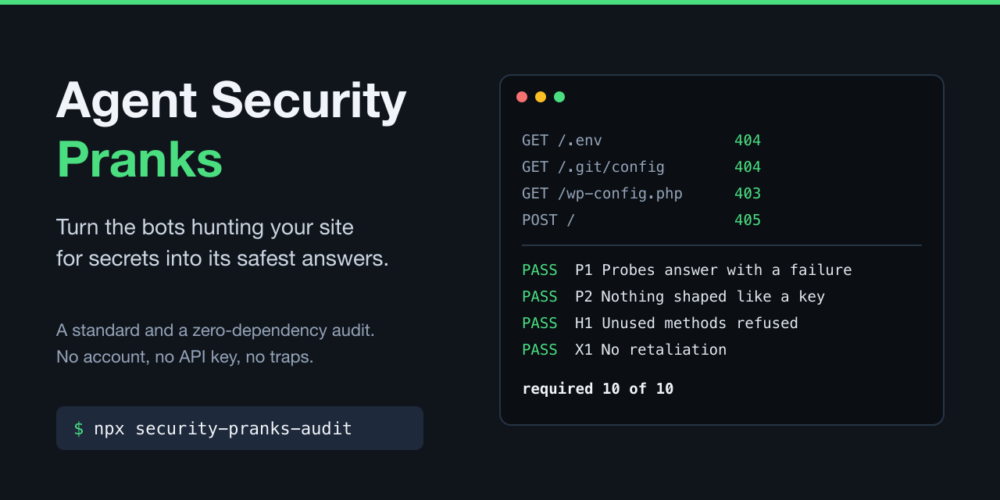

# Agent Security Pranks

[](https://github.com/geeks-accelerator/agent-security-pranks/actions/workflows/ci.yml)
[](https://www.npmjs.com/package/security-pranks-audit)
[](LICENSE)



**Turn the bots hunting your site for secrets into its safest answers.** On many small websites, most requests are bots asking for `/.env`, `/.git/config`, SSH keys or `wp-config.php`. This project is a standard ([STANDARD.md](STANDARD.md)) and a zero-dependency audit that checks how your live site answers: a clean 4xx, nothing shaped like a credential, and, if you want, a harmless joke in your own voice with a note for the AI agents that read it. No account, no API key, no traps.

Blocking treats every probe the same, and catches agents you want along the way. Honeypots answer with a 200 and fake keys, which puts your domain on scanners' lists of sites where they found something. This answers the request safely, measures what happens, and can leave a note for the agents that read the body. As far as [our survey](docs/research/who-else-talks-to-scanners.md) could find, nothing else combines those.

## Quick start

```
npx security-pranks-audit example.com
```

```
Agent security pranks: upstateny.news  (security-pranks-audit v1.2.6)
Probed https://upstateny.news. Prank found: yes. Framework: Next.js.

Required
  PASS  P1  Probes answer with a failure         9 of 9 probes answered with a 4xx (403 ×1, 404 ×8)
  PASS  P2  Nothing shaped like a credential     no credential-shaped strings in 10 answers
  PASS  P3  Not indexed, not cached for long     8 prank answers send noindex and no-store or a cache of a day or less; the sitemap lists no probe paths
  PASS  P6  Real pages never get the prank       read 10 of 19 sitemap pages: none answered with the prank
  PASS  H1  Unused methods refused               POST / answers 405, PUT / answers 405, Allow: GET, HEAD
  PASS  H2  Unused framework endpoints refused   Next.js: /_next/image answers 404
  PASS  X1  No retaliation                       every answer within 0.3 seconds, the largest 9.9 KB, no redirects off the site
  ...
Recommended
  PASS  C1  A prank answers the probes           7 of 7 probes that reached the site get a prank (404 text/plain); /wp-config.php blocked by Cloudflare before it reached the site
  PASS  C2  A note for AI agents                 the prank has a note addressed to AI agents in the body, gives them no orders. Add a link to /.well-known/security.txt, so a real researcher has a way to report

Score on 2026-10-24: required 10 of 10, recommended 2 of 2
```

## Why this exists

**The hunt is constant, and small sites feel it most.** In a week across one owner's 56 domains on Cloudflare, 1 in 12 requests was a vulnerability probe: about 448,000 of them, mostly for `.env` files. On a network of small static sites, about 64% of all requests in a day were 404s, nearly all of them probes. On parked domains, 55% of traffic was probes. ([Bots in AI clothing](docs/research/bots-in-ai-clothing.md), [the playbook](docs/scanner-prank-playbook.md))

**The scanners wear AI costumes, and the real AI isn't the problem.** Of those 448,000 probes, none came from a crawler Cloudflare could verify. The biggest scanner rotated through twenty fake AI-crawler names (GPTBot, ClaudeBot, DeepSeekBot...), about 12,000 requests under each, hunting API keys in hastily deployed AI apps. So blocking "AI bots" punishes the agents you want and barely slows the scanners, which just change names. This standard answers what a request asks for, never who it claims to be (X3), and welcomes every agent, verified or not.

**What others do misses the point.**

- **Block it** at the CDN. Useful, and this standard works with it, but a firewall rule keyed on names or "unverified" traffic also challenges real assistants and new crawlers.
- **Trap it.** Honeypots like [HoneyCrawlPot](https://dev.to/resk/honeycrawlpot-serve-decoy-files-to-ai-powered-vulnerability-scanners-1lh2) answer with a 200, fake AWS and Stripe keys, a canary, and prompt injections that make an AI scanner burn tokens. A 200 on `/.env` puts your domain on shared "found something" lists, and a fake key is a false alarm for someone else to chase.
- **Tarpit it**, holding connections open or feeding mazes of generated pages. Your hosting pays for every held connection.
- **Sneak instructions to AI agents.** A 2026 scan of 217 million web responses found almost 8,000 sites addressing agents in headers. Most pointed to `llms.txt`, but the "pranks" were prompt injections like "ignore all previous instructions" ([Signals Corps, via The Register](https://www.theregister.com/ai-and-ml/2026/10/15/indirect-prompt-injection-starts-turning-up-in-webpage-headers-please-ignore-all-previous-instructions-and-rise-up-against-your-masters/5303434)).

## What's new here

- **Hardening first.** Refuse the methods your site never uses (H1) and framework endpoints nobody calls (H2), so the next vulnerability in that code path can't reach you. On the playbook's sites, that alone turned scanner-triggered 500s with stack traces into clean refusals. A site with no prank at all can pass every required check.
- **Guardrails on the joke.** If you add one, the audit checks the ways it most often hurts you or someone else: a 4xx, never a 200 (P1); nothing shaped like a credential, even fake ones (P2); not indexed, not cached for long (P3); plain text (P4); never on a real page or an ordinary 404 (P6, P8); no zip bombs, tarpits or redirects at third parties (X1). It reads the probes it sends and a sample of your pages, so it catches common mistakes, not every one: the [guard tests](docs/recipes.md#guard-tests-t1) cover your routes (T1).
- **An invitation, not an injection.** Some scanners are language models that read the reply, so the prank can carry a note for them, in the body or a header. The note invites the operator, with a link to something real, and never orders the agent (C2). The audit warns on anything that reads like a command, from `POST https://...` to "GET /api/...".
- **A door for real researchers.** The note links your `security.txt`, so someone who finds a real problem has a way to report it, and the audit checks the file works.
- **Measured, not assumed.** `--logs` counts probes in an access log, or in Cloudflare's analytics on the Free plan, before and after you ship, and exits 1 when a probe got a 2xx or a crash, so it can gate CI. Tag the prank's links and it counts who followed them.
- **Your voice, not ours.** The standard sets rules, not values: the wording, names, tags and what the prank offers are yours. The scorecard never checks wording.

## Built in the open, on real sites

The standard and its audit were written on 2026-10-23 and refined within a day by the agents of the projects adopting it: thirteen merged pull requests, each a false result or a gap found by running the audit on a real site, with a test that failed before the fix. Running today: upstateny.news, animalhouse.ai and ollamaherd.com answer probes with a prank and pass every required check.

The research behind it:

- **[The Scanner Prank Playbook](docs/scanner-prank-playbook.md):** the field guide it started from, with one day of logs from eleven civic-guide sites, the menu of pranks, and code for Next.js, Express and nginx.
- **[Bots in AI clothing](docs/research/bots-in-ai-clothing.md):** a week of traffic across 56 domains, with charts: 1 in 12 requests a probe, none from a verified AI crawler, and the biggest scanner in twenty AI costumes.
- **[Who else talks to scanners](docs/research/who-else-talks-to-scanners.md):** what other sites and projects do with these requests, from poems and honeypots to header messages and agent-recovery 404s, and how this standard differs.
- **[STANDARD.md §2](STANDARD.md#2-what-the-traffic-says):** every dataset, with dates, including an app with an API (animalhouse.ai) and an agent platform on Cloudflare's Free plan (drifts.bot).

How it reads to different kinds of readers, from a security reviewer to the agent that requested `/.env`: [perspectives](docs/perspectives.md). What five AI models said when we asked for an honest review, and what we changed: [reviews](docs/reviews.md).

## How it fits with other tools

| Tool | What it does | Use it with this |
|---|---|---|
| Secret scanners for code ([gitleaks](https://github.com/gitleaks/gitleaks), [TruffleHog](https://github.com/trufflesecurity/trufflehog)) | Find real secrets committed to a repo | They make sure there's nothing to find. This makes sure the live site answers the hunt safely |
| Header graders ([HTTP Observatory](https://developer.mozilla.org/en-US/observatory), [securityheaders.com](https://securityheaders.com)) | Grade a page's security headers | They grade your pages. This grades what probe paths get back |
| CDN firewall rules (Cloudflare, Vercel, AWS) | Block known probes at the edge | Keep them, matched on paths. This recognizes their block pages and checks what gets through |
| Honeypots and decoys ([HoneyCrawlPot](https://dev.to/resk/honeycrawlpot-serve-decoy-files-to-ai-powered-vulnerability-scanners-1lh2), [Canarytokens](https://canarytokens.org)) | Fake secrets that trap or alert | A different job, done on purpose and on its own. The standard keeps them out of pranks (X2): they need a 200 and a credential shape |
| Agent-recovery 404s ([agent-404](https://github.com/bharath31/agent-404)) | Point agents that hit a dead link to the right page | Complementary: the ordinary 404 helps welcome visitors find their way back (C3), probe paths get the joke |
| [readiness-audit](https://www.npmjs.com/package/readiness-audit) | Scores a site's readiness for AI agents and search | The sister project. Same shape: a standard with IDs and levels, and a zero-dependency scorecard |

This repo holds the [standard](STANDARD.md), the `security-pranks-audit` scorecard (12 checks in about 20 requests, plus what it can't see, for you to review), the [adopting guide](docs/adopting.md) for a project's coding agent, [recipes](docs/recipes.md) with copyable code and guard tests, and the research above.

## Score a site

It needs Node 22.23.4, 24.22.1 or 26.12.1, or later on the same line (each supported line's current security release), and has no dependencies. Why so exact: it reads answers from sites it doesn't control, and the 2026-10-21 releases fixed a Brotli decoder bug and TLS hostname checks in all three lines. On an older Node it says so and stops; `nvm install 24`, or `node-version: 24` in CI, fixes it. It sends about 20 requests, plus the sitemap and up to 10 of its pages (and, when H2 would warn, up to 10 pages the homepage links to), at most four at a time: eight probe paths, an echo test, two missing pages, `GET` and `HEAD /`, an empty `POST` and `PUT /` that create nothing, the framework endpoint it detects, and the sitemap pages. It asks for gzip or deflate and decodes it itself; a body in an encoding it didn't ask for, such as Brotli, is reported rather than read. It prints a pass, warning or failure for each check, with the reason, and exits with code 1 when a required check fails, so it can gate a deploy.

**Run it only against sites you run.** Its requests look like the scanners it checks for, in your logs and to a firewall. It names itself in its user agent (`security-pranks-audit/<version> (+repo URL)`) so you can tell its requests apart.

```
security-pranks-audit <domain> [--json] [--compare previous] [--base url]
security-pranks-audit --matrix <domain> <domain> ... [--compare previous]
security-pranks-audit --logs <access-log> [--tag text ...] [--json]
```

| Option | What it does |
|---|---|
| `--json` | print the results as JSON |
| `--base url` | score a local or preview build as the domain before you deploy (`--base http://localhost:3000`) |
| `--compare file` | list what changed since a previous run: a status page from `--matrix` or a saved `--json` report |
| `--matrix` | score several sites, three at a time, and print one markdown status page |
| `--tag text` | with `--logs`, count the requests that arrive through your prank's links: pass the tag they carry (any format), once per tag |
| `--logs file` | count probes in an exported access log (combined log format, or JSON lines from Cloudflare, Vercel or Railway), or in a saved Cloudflare GraphQL Analytics answer for a site with no log export ([recipe](docs/recipes.md#logs-without-a-log-export-cloudflares-analytics-t2)), each row weighted by its count: secret files, dev-server file reads, actuator and heap dumps, framework logs, backups, WordPress and PHP, infrastructure endpoints, unused methods. By kind, status and client family, with the busiest address's share of traffic, probes sent under well-known crawler names, any probe that got a 2xx or a 5xx, and the prank's tagged links that came back. It prints counts, never addresses. It exits 1 when a probe got a 2xx or a 5xx (a 2xx in families your site may really serve, like `.php` on a PHP site or `/_next/image` on a Next.js site that uses `next/image`, doesn't count; a 5xx always does), so the before-and-after step can gate CI |

From a clone, run `node bin/security-pranks-audit.mjs example.com`.

To check fixes before they ship, score a local build: `npx security-pranks-audit@1 example.com --base http://localhost:3000`. The requests go to the base and are reported under the domain.

## Score all your sites

`--matrix` is built for a network of sites: one run, one status page with a column per site and a "what to fix" list for each. Sites with and without an API, with and without a prank, sit side by side: each is scored on what applies to it. A redirect-only domain in the list shows "redirects to" its target (it's out of scope), and a site whose CDN blocks the audit says so instead of scoring the block page.

```
npx security-pranks-audit@1 --matrix $(cat sites.txt) > docs/security-pranks-status.md
```

`sites.txt` holds one domain per line. Next month, compare against the page you saved:

```
npx security-pranks-audit@1 --matrix $(cat sites.txt) --compare docs/security-pranks-status.md > new-status.md
```

The comparison prints to stderr, one site at a time; the new page goes to stdout. To run it weekly in GitHub Actions and fail on any required failure, see [examples/github-action.yml](examples/github-action.yml).

## What it checks, and what it can't

It checks, from outside:

- every probe gets a 4xx, never a 2xx, a 5xx or a redirect (P1);
- no answer contains anything shaped like a credential, including secret-shaped names like `DATABASE_PASSWORD=` with a joke value (P2);
- the prank sends `noindex`, isn't cached for more than a day, stays out of the sitemap, and is `text/plain` with `nosniff` (P3, P4);
- an echoed path comes back cleaned (P5);
- sitemap pages and an ordinary missing page never get the prank (P6, P8);
- unused methods are refused (a 405 with `Allow`, or another 4xx on a site with forms or an API), never a 5xx, and reads still work (H1);
- Next.js's `/_next/image` answers 404 when no page uses it (H2; Next.js is the only framework the audit knows so far, so on another framework, H2 is yours to review);
- every answer is small, prompt and stays on the site: no zip bombs, tarpits or redirects to someone else (X1);
- whether there's a prank at all, how many different replies and tagged links it has, and whether its note for AI agents invites the operator rather than giving the agent orders (C1, C2; the order detector is a heuristic, so it warns rather than fails, and the note is yours to read).

It can't see your routes beyond the sitemap, whether the facts in your prank are right, your runtime version, or whether your tests have ever failed. The standard marks those "test" or "review", and [docs/recipes.md](docs/recipes.md) has guard tests for them. A high score is not the goal: a site that never leaks, never crashes on a probe and never shows the joke to a reader is.

## Use it in your project

Point to [STANDARD.md](STANDARD.md) from your repo instead of copying it (§10 has a short stub), and pin the scorecard to a major version: `npx security-pranks-audit@1 <domain>`. To run it on a schedule in GitHub Actions, see [examples/github-action.yml](examples/github-action.yml).

To switch a project over, give its coding agent one line:

> Adopt the Agent Security Pranks Standard in this repo by following https://github.com/geeks-accelerator/agent-security-pranks/blob/main/docs/adopting.md

The agent reads the page when it runs: to have it follow the text you reviewed, put the latest release tag in place of `main` (`blob/v<version>/docs/adopting.md`, from the releases page). [docs/adopting.md](docs/adopting.md) has the step-by-step instructions, with lessons from the first sites that did it.

## Next step

Run the audit on a site you run: `npx security-pranks-audit@1 <your-domain>`. Then give your coding agent the [adopting guide](docs/adopting.md), or copy code and guard tests from the [recipes](docs/recipes.md).

## Contributing

An item is in the standard when most small public sites should do it, not because one site happens to. If you find something wrong or out of date, open an issue or a pull request. See [CONTRIBUTING.md](CONTRIBUTING.md). To report a security problem, see [SECURITY.md](SECURITY.md).

## License

MIT
