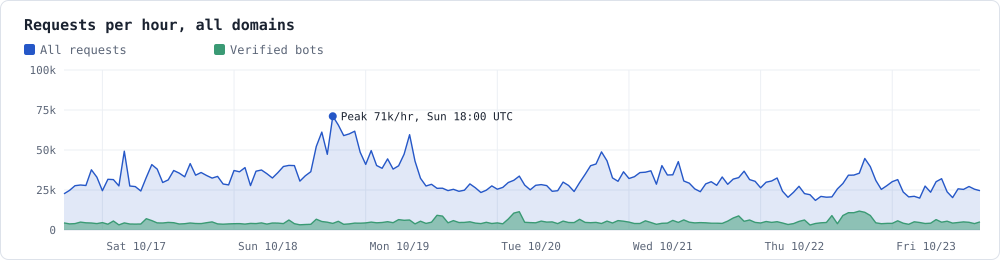
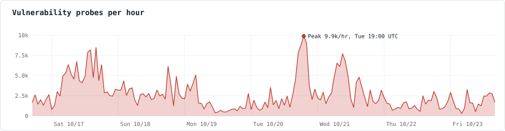
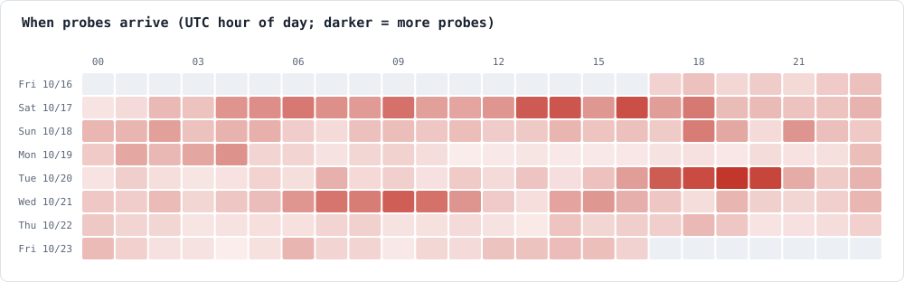
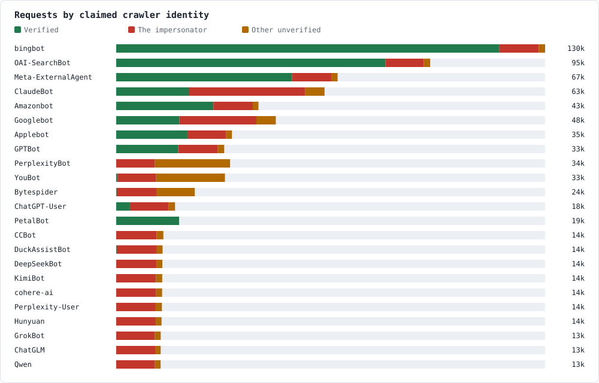
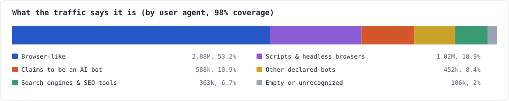
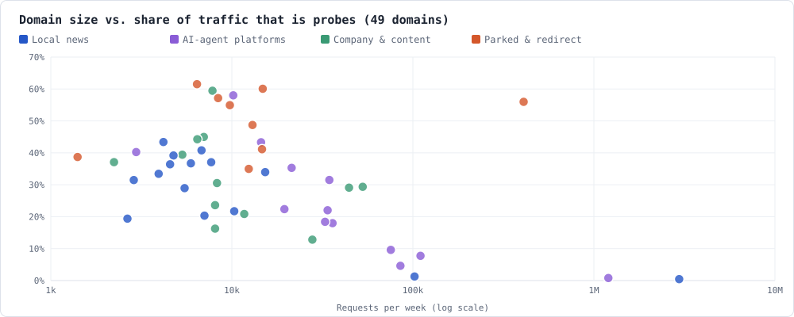
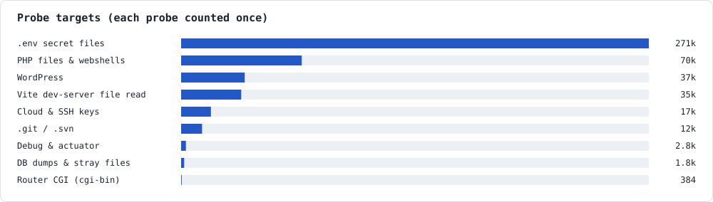
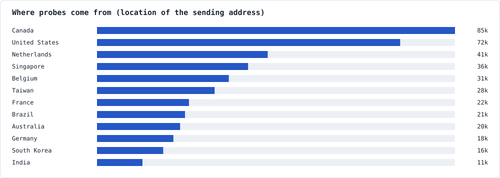
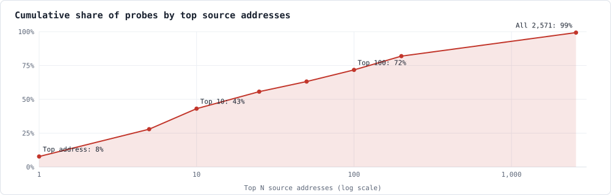
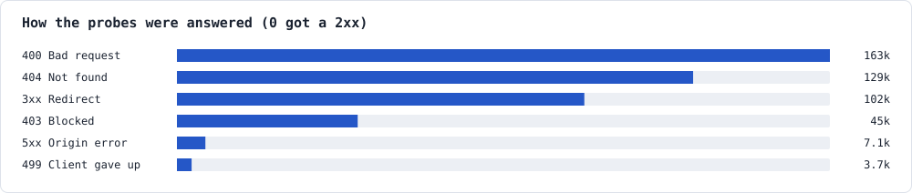

# Bots in AI clothing

*Field notes: 56 domains on Cloudflare, 7 days, October 16 to 23, 2026*

We looked at a week of traffic across every domain we run to answer one question: how much of it is bots, AI crawlers and agents, and how much is hunting for security holes?

Our portfolio: 15 local news sites, 13 AI-agent platforms, 12 small company and content sites, and 9 parked or redirect-only domains. That's 49; the other 7 of our 56 domains got 18 requests between them all week, so they're in the totals but left out of the per-site charts. All on Cloudflare's Free plan. Counts are Cloudflare's sampled estimates.

> This research is evidence for the [Agent Security Pranks Standard](../../STANDARD.md) (§2). The standard covers websites you run and manage; the parked domains are in the data because they show what scanners do, not because the standard applies to them. The section [What it changed in the standard](#what-it-changed-in-the-standard) replaces the original report's recommendations, which proposed challenging unverified crawler names. The standard welcomes every agent, verified or not (X3).

## What we found

- **1 in 12 requests was a vulnerability probe.** About 448k in a week, mostly hunting for `.env` files full of API keys.
- **The real AI crawlers weren't doing it.** Of those 448k probes, **zero** came from a bot Cloudflare could verify.
- **The biggest scanner dressed up as AI crawlers.** It rotated through about 20 fake identities (GPTBot, ClaudeBot, DeepSeekBot, GrokBot, KimiBot and more), each used almost exactly 12,000 times.
- **Small sites are mostly scanner food.** On parked domains, 55% of all traffic was probes. On busy news sites, 1.3%.
- **Nothing got through.** Not one probe received a successful response.

| | |
|---|---|
| **5.50M** | requests across 56 domains |
| **846k** | from Cloudflare-verified bots (15.4%) |
| **305k** | verified AI crawlers, AI search and assistants (5.5%) |
| **448k** | vulnerability probes (8.1%) |
| **43%** | of all probes came from just 10 addresses |
| **0** | probes that got a 2xx response |

## A week, hour by hour

Probe traffic is bursty. Campaigns switch on, hammer for a few hours, and switch off, independent of normal traffic.

No daily rhythm. Human traffic follows the sun; scanners follow their own job schedules.

## The impostor chart

Every request that names a well-known crawler, split by whether Cloudflare could verify it came from that company. Look at the red: one scanner, almost exactly 12,000 requests under each name, rotating through them like a deck of cards.

"Unverified" doesn't always mean fake: some real crawlers had no verified traffic at all this week. The red segment is the part we're sure about: same scanner, same addresses, same probe paths. Names it used in two or three variants show 24k or 36k. The 23 names here add up to 296k impersonator requests; it also used Meta-WebIndexer and a Googlebot-style phone agent, for 308k in all.

## What the traffic says it is

Grouped by user agent (98% coverage). The Free plan has no bot score, so "browser-like" only means the request *looks* like a browser.

| Group | Requests | Notes |
|---|---|---|
| Browser-like | 2.88M (53.2%) | People, plus bots spoofing Chrome or Safari |
| Scripts and headless browsers | 1.02M (18.9%) | Node, python-httpx, Lightpanda, curl, HeadlessChrome, MCP clients. Much of it is agents we want, or our own workers |
| Claims to be an AI bot | 588k (10.9%) | Only about half verifies |
| Other declared bots | 452k (8.4%) | Newer AI crawlers, brand monitors, link indexers |
| Search engines and SEO tools | 363k (6.7%) | Bingbot, Ahrefs, Googlebot, Semrush |
| Empty or unrecognized | 106k (2.0%) | An empty user agent is a classic scanner tell |

## Small sites are scanner food

Each dot is one of the 49 domains that saw traffic. The less real traffic a site gets, the bigger the share that's attack noise. Scanners don't care how popular you are; they find new domains through public certificate logs within hours.

| Site type | Domains | Requests | Probe share | Verified AI share |
|---|---|---|---|---|
| Local news | 15 | 3.14M | 1.3% | 5.6% |
| AI-agent platforms | 13 | 1.68M | 5.1% | 7.1% |
| Company and content | 12 | 190k | 28.3% | 4.0% |
| Parked and redirect | 9 | 490k | 55.0% | 0.2% |

## What the probes want

All 448k probes, each counted once under its first matching target. Every one asks for something none of our sites serve.

Nearly all of it is rented cloud servers, so the second chart shows which data centers scanners rent, not who runs them.

## A few machines, most of the noise

2,571 distinct addresses sent probes, but the distribution is extremely lopsided. Blocking the top 10 would have removed 43% of the week's probes.

400s are Cloudflare rejecting malformed requests. 403s are its free managed rules. 3xx are redirects that drop the path. 5xx are origins that were down at the time.

## The campaigns behind it

Most probe traffic traces back to a handful of operations with clear fingerprints.

### The AI-crawler impersonator

*308k requests, 173k probes*

- **Target:** mostly one parked domain that only redirects elsewhere: 408k requests in a week, against 390 real visits. 308k of them carried fake crawler names.
- **Split:** 173k of the 308k hit our probe list, which makes this one scanner 39% of all probes. The other 135k asked for paths our list doesn't cover: `/api/fs/read`, `/api/system/fileView`, `/ssl/localhost.key`, `rclone.conf`, source maps, and generic `/admin`, `/login` and `/api` routes. Those are reconnaissance too, so our probe count is conservative. Other scanners sent the domain's remaining 55k probes.
- **Sources:** about 10 Google Cloud VMs in Canada, Singapore, Taiwan, the Netherlands, Brazil and the US, plus one more US host. The busiest single VM sent 63k requests.
- **Disguise:** round-robins about 20 fake crawler identities: GPTBot, OAI-SearchBot, ClaudeBot, DeepSeekBot, GrokBot, KimiBot, Hunyuan, ChatGLM, Qwen, cohere-ai, CCBot, DuckAssistBot, Meta-ExternalAgent, bingbot, and a Googlebot-style phone agent. None verify.
- **Targets:** `.env` files in AI-app folders (`/agents/.env`, `/chatbot/.env`, `/pipeline/.env`), Vite `/@fs/` file reads ([CVE-2025-30208](https://nvd.nist.gov/vuln/detail/CVE-2025-30208)), `/__vite_rsc_findSourceMapURL` ([CVE-2025-68155](https://nvd.nist.gov/vuln/detail/CVE-2025-68155)), `/proc/self/environ`, `.env::$DATA` (a Windows trick), `.gitconfig`.
- **Our read:** it's hunting LLM and cloud API keys in hastily deployed AI apps, and it wears AI-bot names to slip past rules that wave AI crawlers through. The even rotation and fixed wordlist look like a script in an AI costume, not an autonomous agent.

### WordPress installer hijacking from Cloudflare Workers

*38 of 56 domains*

- **Source:** one address in Cloudflare's own Workers egress range: someone is running a scanner on a Worker.
- **Pattern:** only `GET /wp-admin/install.php?step=1`, with the user agent set to the target URL. It also guessed lookalike domain names that don't exist.
- **Goal:** finding fresh WordPress installs and claiming them before their owners finish setup.

### Webshell hunters on Azure

*13 to 19 domains per address*

- **Sources:** Microsoft Azure VMs in South Korea, Australia and India, 3k to 5k requests each.
- **Pattern:** empty user agent; hundreds of PHP filenames that other attackers' webshells leave behind: `/sm.php`, `/gulu.php`, `/this_is_a_new_hello_world.php`.
- **Goal:** reusing someone else's break-in rather than doing their own.

### Secrets and debug-endpoint sweepers

*Many domains*

- **French hosting range:** empty user agent, 7.5k requests from one address; Spring `/actuator/heapdump`, `/.env.save`, `/db.sql`.
- **German host:** Mac Chrome user agent across 15 domains; `.env.staging`, `.git/HEAD`, `config/.env`.
- **AWS host:** infrastructure paths: `/k8s/`, `/payload.config.js`, `/telescope/api/requests`, `/alertmanager/`.

## What it changed in the standard

Nothing was breached. The findings shaped these parts of the [Agent Security Pranks Standard](../../STANDARD.md):

- **Welcome every mind; answer the behavior (principle 8, X3).** The real AI crawlers didn't probe, and the biggest scanner wore twenty crawler names. So nothing in the standard blocks or challenges a visitor for its user agent, its claimed name or its verified status. A rule that keys on names breaks the agents a site wants (an assistant fetching for a person, a crawler not yet on anyone's verified list) and barely slows a scanner that changes its name.
- **Edge rules match probe paths (H4).** No welcome visitor asks for `/.env`, `/wp-admin` or `/@fs/`. A Cloudflare Free plan custom rule can block the probe families a site's prank doesn't answer, matched with `starts_with` and full segments so article slugs stay safe. The rule is in [docs/recipes.md](../recipes.md#cloudflare-on-the-free-plan-h4-x3).
- **Keep agents welcome at the CDN (H4).** On the Free plan, Bot Fight Mode can't be skipped by any rule, so it challenges scripts, headless browsers and MCP clients along with the scanners: keep it off on sites that welcome agents. Check that the AI bot settings allow the agents you welcome.
- **`--logs` counts probes sent under well-known crawler names,** and the new probe families this week showed: dev-server file reads, version-control files and infrastructure endpoints.

### Keep the boring hygiene

- Never expose a Vite dev server to the network. The `/@fs/` probes target Vite's 2025 file-read bugs ([CVE-2025-30208](https://nvd.nist.gov/vuln/detail/CVE-2025-30208), then [31125](https://nvd.nist.gov/vuln/detail/CVE-2025-31125), [31486](https://nvd.nist.gov/vuln/detail/CVE-2025-31486) and [32395](https://nvd.nist.gov/vuln/detail/CVE-2025-32395)), and `/__vite_rsc_findSourceMapURL` targets [CVE-2025-68155](https://nvd.nist.gov/vuln/detail/CVE-2025-68155) in `@vitejs/plugin-rsc` before 0.5.8. All of them only affect dev servers reachable over the network.
- Keep secrets in your platform's environment variables, never in files under `public/` or the build output.
- Put admin and log endpoints behind a key, and check they return 401 without one.

## How we measured

- Cloudflare GraphQL Analytics (`httpRequestsAdaptiveGroups`, `firewallEventsAdaptive`) for all 56 zones, October 16 17:00 UTC to October 23 17:00 UTC.
- "Probe" means a request whose path matches one of 21 patterns: `.env`, `/.git/`, `/.svn/`, `.gitconfig`, `/@fs/`, `__vite`, `wp-admin`, `wp-login`, `wp-content`, `wp-includes`, `xmlrpc`, `.php`, `actuator`, `heapdump`, `.aws`, `/.ssh`, `id_rsa`, `.sql`, `.DS_Store`, `cgi-bin`, `phpinfo`. None of our sites serve any of them. 98 matches were article URLs containing "invite" (the `_` in `__vite` is a wildcard in Cloudflare's analytics filter); we removed them. Broader patterns like "backup" or "environ" matched real article slugs, so we left those out, which makes the probe count conservative.
- "Verified" is Cloudflare's verified-bot flag, which checks the source address and signature against the vendor's.
- Totals, probe targets, hourly series, countries and response codes are full counts, not top-N. The user-agent breakdown uses the top 300 agents per domain (98% of requests), and the address curve uses the top 100 addresses per domain (99% of probes).
- Limits: the Free plan has no bot score or ASN data. Counts are sampled estimates, and separate queries over the same week can differ by up to 0.5%, so the charts' probe totals range from 447.6k to 449.7k.
- Edge logs can't prove whether a scanner is driven by an LLM. Everything here looks like ordinary scripted scanning.
- The charts are rendered from the week's numbers by [bots-in-ai-clothing/charts.mjs](bots-in-ai-clothing/charts.mjs), with the data in [data.json](bots-in-ai-clothing/data.json): `node docs/research/bots-in-ai-clothing/charts.mjs`.

## Further reading

- [Cloudflare AI Crawl Control: bot reference](https://developers.cloudflare.com/ai-crawl-control/reference/bots/), the AI crawlers Cloudflare identifies.
- [Sysdig Threat Research (May 2026)](https://sysdig.com/blog/ai-agent-at-the-wheel-how-an-attacker-used-llms-to-move-from-a-cve-to-an-internal-database-in-4-pivots): an LLM agent ran the post-exploitation phase of a Marimo intrusion (CVE-2026-39987), fanning 12 cloud API calls across 11 Cloudflare Workers addresses in 22 seconds to defeat per-address detection.
- [Unit 42 2026 Global Incident Response Report](https://www.paloaltonetworks.com/resources/research/unit-42-incident-response-report), built on 750+ incident response cases. It finds AI already reducing attacker friction across reconnaissance, social engineering, scripting and extortion.
